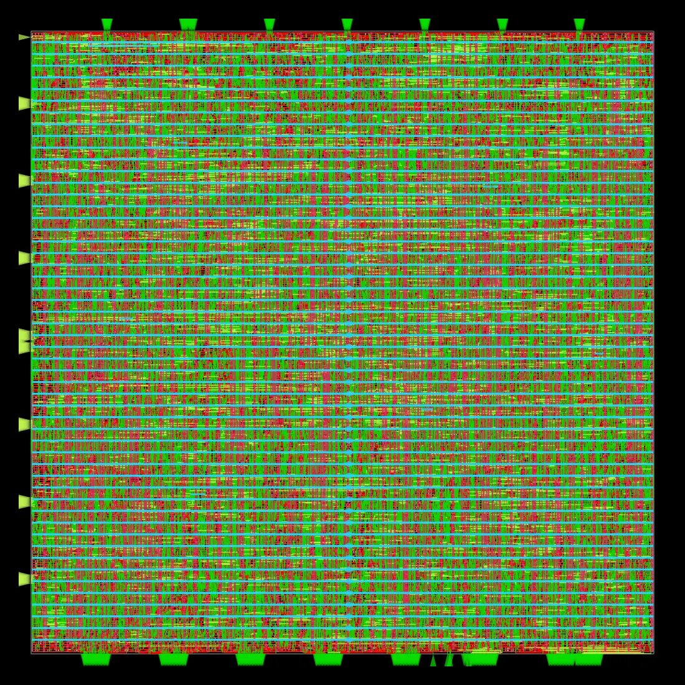
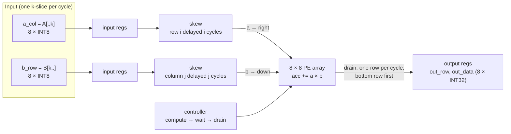
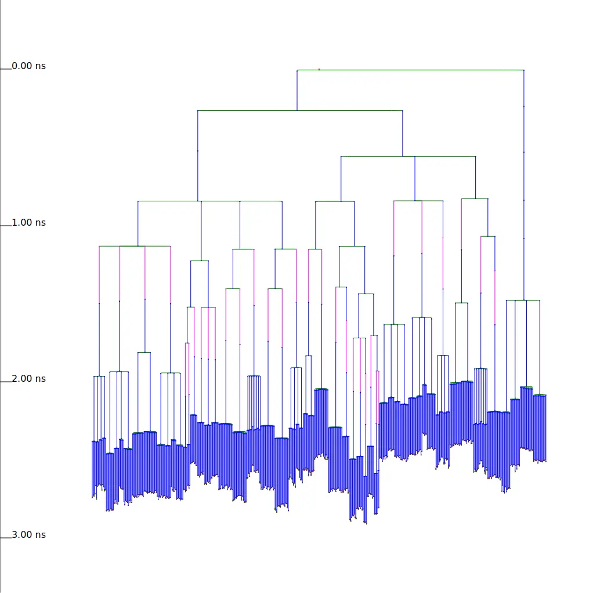
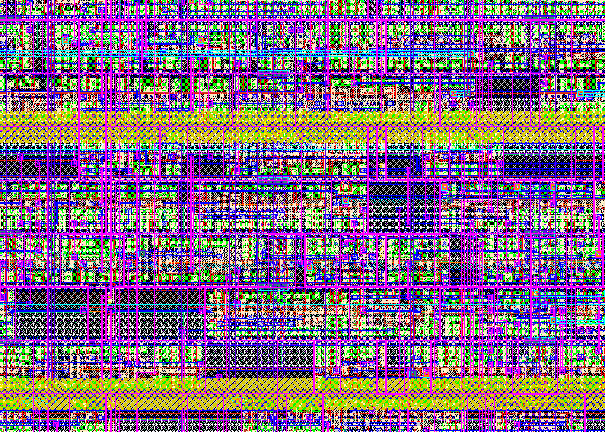
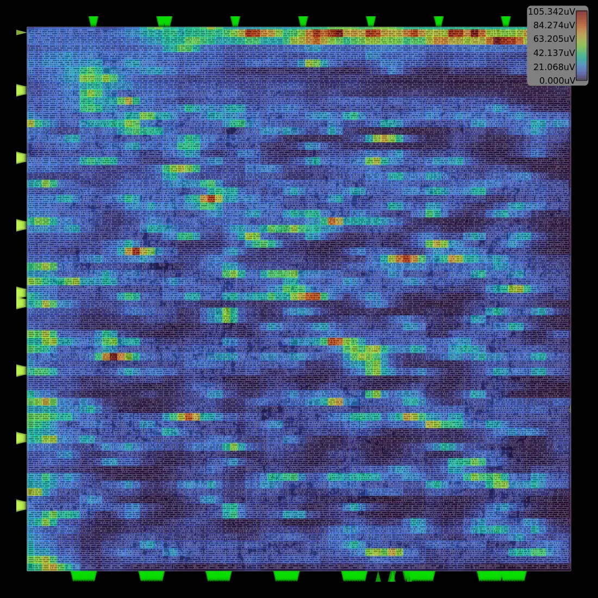

# 8×8 INT8 Systolic Array: RTL to GDSII on SkyWater 130 nm

A matrix-multiply accelerator: an 8×8 grid of INT8 multiply-accumulate processing elements (PEs).
It is written in SystemVerilog, verified against a NumPy model, and taken through the full open-source
physical-design flow (OpenROAD-flow-scripts on the **sky130hd** library) to a **block-level, signoff-clean
GDSII**: timing met at three process corners and six RC-extraction corners, DRC clean in two tools,
LVS clean in two tools, antenna clean, IR drop checked, and gate-level simulation passing with back-annotated delays.


*The final layout (722.8 × 722.8 µm, rendered by OpenROAD). Pins: activations enter on the left, weights on the
top, results leave on the bottom.*

| | Final layout (EXP-033-ECO) |
|---|---|
| Technology | SkyWater SKY130, `sky130_fd_sc_hd` standard cells |
| Function | C (8×8, INT32) = A (8×K, INT8) · B (K×8, INT8), K = 1 … 2¹⁷−1 per job |
| Clock | 10 ns (100 MHz) signoff target; reported Fmax **102.4 MHz** at ss_100C_1v60 |
| Peak throughput | 64 MAC/cycle = 6.4 GMAC/s = 12.8 GOPS at 100 MHz |
| Die | 722.8 × 722.8 µm = **0.522 mm²** (block, no pad ring) |
| Logic | 363,646 µm² after synthesis; 4,845 flip-flops, 32 integrated clock gates |
| Power (tt, 100 MHz, dense matmul) | **80.65 mW, 17.33 pJ/MAC, 115 GOPS/W**; idle 5.36 mW |
| Signoff | Setup/hold met at ss/tt/ff + 6 RC corners · DRC 0 (Magic, KLayout) · LVS match (Netgen, KLayout) · antenna 0 · timed GLS pass |

---

## Contents
1. [Architecture](#architecture)
2. [Verification](#verification)
3. [Physical design](#physical-design)
4. [Signoff results](#signoff-results)
5. [Clock gating: before and after](#clock-gating-before-and-after)
6. [Design-space exploration](#design-space-exploration)
7. [Side experiment: SRAM weight buffer](#side-experiment-sram-weight-buffer)
8. [Repository layout](#repository-layout)
9. [Reproducing the results](#reproducing-the-results)
10. [Scope and limitations](#scope-and-limitations)

---

## Architecture

**Output-stationary dataflow.** PE(i, j) keeps the running sum for C[i][j] in its own 32-bit accumulator.
Activations (A) move right one PE per cycle and weights (B) move down. After the last term, the
accumulators shift down the columns and leave the array one row per cycle.



Key decisions (each one is written up with options and trade-offs in [`notes/design-decisions.md`](notes/design-decisions.md)):

| ID | Decision |
|---|---|
| D-001 | Output-stationary dataflow |
| D-002 / D-006 | Signed INT8 × INT8, INT32 accumulate, two's-complement wrap on overflow |
| D-005 | No global clear: a `first` flag travels with the data; `acc ← first ? a·b : acc + a·b` |
| D-008 | A `valid` flag travels with the activation; invalid cycles (bubbles) hold the accumulator |
| D-011 / D-012 | One k-slice per cycle, skewed inside the block; valid/ready input, valid-only output |
| D-013 / D-014 | Stop-and-drain through the accumulator shift chain; one row of C per cycle |
| D-015 | Every top-level input and output is registered (clean I/O timing budgets) |
| D-016 | Two-stage MAC (product register) to break the multiply → accumulate path |
| D-017 | Data-register enables so synthesis can insert integrated clock gates (ICGs) |

**PE (`rtl/pe.sv`).** One signed 8×8 multiplier, a 16-bit product register, and a 32-bit accumulator.
The `first` and `valid` flags pass along with the activation, so a new job needs no clear cycle.

**Timing of one job** (E0 = the clock edge that accepts the last k-slice, N = 8, P = 1):
results come out on the N edges E0+2N+P … E0+3N−1+P, bottom row first, and the next job can start at
E0+3N+P. The testbench checks these exact cycles.

**RTL size:** 491 lines in 4 modules (`pe`, `skew`, `pe_array`, `systolic_top`), parameterized in N.

---

## Verification

Testbenches are cocotb on Verilator 5.052 (and Icarus 12). The reference is an independent Python/NumPy model
(`model/golden.py`) that computes with exact integers and then wraps to INT32.

| Level | What is checked | Result |
|---|---|---|
| Golden model | wrap boundaries, edge products, matmul vs. exact math, cycle-level PE model | 5/5 |
| PE | reset, signed extremes (−128 × −128), bubbles hold the sum, overflow wrap (2¹⁷ terms), drain priority | 7/7 |
| Skew | per-lane delay, reset mid-stream, 5 configurations | 5/5 |
| Top | identity, K = 1, K = 64 extremes, 40 random jobs with random bubbles, back-to-back jobs at the minimum gap, reset mid-job and mid-drain | 6/6 for N = 1, 2, 4, 8 × PIPE_MAC 0/1, with GATE_DATA 0 and 1 |
| Gate-level (final netlist) | the same top-level tests on the routed netlist with SDF delays | 7/7 at ss and at ff |

Each top-level job is checked for **values, row order, and the exact output cycles**, plus white-box checks
(for example, reset must flush every valid flag still in the skew lines). Testbench quality was checked by
**mutation testing**: deliberately broken RTL copies (wrong sign extension, drain one cycle early, flag not reset…)
must fail. Every mutant was caught by at least one level of the suite except one provably equivalent mutant.
One mutant is masked at the top level by the drain's zero shift-in, so it is caught only by the PE tests.

---

## Physical design

The flow is OpenROAD-flow-scripts with an out-of-tree configuration in `pd/`. Optimization, signoff STA and
the final checks all use the **slow corner** (`ss_100C_1v60`). The SDC adds 0.25 ns clock uncertainty and ±5%
on-chip-variation derates.

### Placement maps onto the array


The 8×8 logical array shows up as an 8×8 physical grid without any placement constraints: PE(0,0) sits
top-left, where both operand streams enter, and PE(7,7) bottom-right. Pins are assigned per lane:
`a_col` row i on the left edge at row i's height, `b_row` column j on the top edge, `out_data` column j on the
bottom edge (`pd/io_dataflow_lanes.tcl`). This removed long input nets and their slew violations (EXP-024).

### Clock tree with clock gates



The clock tree from CTS (latency from the clock root on the vertical axis, sinks at the bottom). Sink
latencies spread from about 2.0 to 2.9 ns. Synthesis creates **one integrated clock gate (ICG) per enable net**,
and in a systolic array every PE on an anti-diagonal sees the same skewed `valid`. So 15 anti-diagonals × 2 enable groups + 2 = 32 ICGs gate 4,355 of the
4,845 flip-flops.

### Real layout



A 30 × 22 µm window of the final GDS (KLayout, SKY130 layer colors): standard-cell rows with their met1 power
rails, local routing, and the wide met4/met5 power straps.

### Post-route fixes (ECOs)

The final layout is the EXP-033 flow output plus two small, scripted engineering change orders (ECOs).
Each one is followed by a full re-signoff.

| ECO | Why | What |
|---|---|---|
| Hold buffers (`pd/eco/eco_hold_buffers.tcl`) | With clock gating, the gated capture clock arrives ~0.25 ns late at ff. Hold failed at ff (−0.031 ns) and tt, and ORFS repairs hold only at the corner it optimizes (ss). | 50 delay cells (38 `dlygate4sd1_1`, 12 `buf_2`) in front of the failing D pins, placed in free row gaps, incremental global + detailed route. No existing cell moves. |
| Antenna diodes (`pd/eco/eco_antenna_diodes.tcl`) | Magic's antenna check flags gate pins with a metal-to-gate area ratio over 400. | 4 `diode_2` cells over 3 rounds. Each reroute disturbed a neighboring net, so later rounds ran Magic right after the ECO. |

A rerun from CTS with a hold margin was also tried (EXP-034). It fixed hold but rebuilt the clock tree,
and setup failed at ss + max RC (−0.102 ns). The local ECO was kept because it moves nothing else.

---

## Signoff results

Final layout EXP-033-ECO, round 3. Timing comes from OpenSTA. The 6 RC corners use OpenRCX extraction with the
open_pdks min/nom/max rules.

| Corner | Setup WNS (ns) | Hold WNS (ns) |
|---|---|---|
| ss_100C_1v60 | +0.239 | +0.273 |
| tt_025C_1v80 | +3.748 | +0.091 |
| ff_n40C_1v95 | +4.481 | +0.031 |
| ss + nominal RC | +0.240 | +0.286 |
| ss + **max** RC (worst setup) | **+0.135** | +0.283 |
| ss + min RC | +0.337 | +0.288 |
| tt + nominal RC | +3.745 | +0.099 |
| ff + **min** RC (worst hold) | +4.552 | +0.033 |
| ff + max RC | +4.419 | +0.032 |

Max slew / max capacitance / max fanout violations: **0 at every corner.**

| Check | Tool | Result |
|---|---|---|
| DRC (full rule deck incl. FEOL) | Magic 8.3.697 (`drc(full)`) | 0 |
| DRC (BEOL) | KLayout, ORFS sky130hd deck | 0 |
| DRC (open_pdks deck: FEOL + BEOL + off-grid + floating metal) | KLayout | 0 |
| LVS | Netgen | "Circuits match uniquely" |
| LVS | KLayout | "Netlists match" |
| Antenna | OpenROAD and Magic | 0 / 0 |
| Static IR drop | OpenROAD PDNSim | worst 0.32 mV (ff), 0.26 mV (ss) |
| Gate-level simulation, SDF | Icarus + cocotb | 7/7 at ss, 7/7 at ff |



*Static IR-drop map on VSS from the ORFS finish step (max 105 µV). The block-level grid is far from being a limit.*

---

## Clock gating: before and after

The last RTL change (D-017) gave the data registers (operands, product, I/O) enables that are on only while
their data is valid. Synthesis (`INFER_CLKGATES`) then replaces the enable muxes with ICGs. The comparison is
the **same RTL** with `GATE_DATA=0` (EXP-032) vs `GATE_DATA=1`. Power was measured at tt with switching activity
from SDF-timed gate-level simulation, over four workloads.


| | No gating (EXP-032) | Gating, final (EXP-033-ECO) | Change |
|---|---|---|---|
| Idle power | 40.27 mW | 5.36 mW | **−87%** |
| Dense matmul | 87.40 mW · 18.78 pJ/MAC | 80.65 mW · 17.33 pJ/MAC | −8% |
| Sparse (A, B each 50% zeros) | 61.60 mW | 55.30 mW | −10% |
| Drain phase | 68.15 mW | 50.47 mW | −26% |
| Synthesized area | 381,772 µm² | 363,646 µm² | −4.7% |
| Routed wirelength | 1,085,749 µm | 1,010,494 µm | −6.9% |

- **Idle:** without gating, idle power is almost all clock power: the tree plus every flop's clock pin.
- **Area:** gating *reduced* area, because one ICG replaces a hold mux on every flop of its group.
- **Cost:** gated clocks arrive later, which created the ff hold violations that the hold-buffer ECO fixed.

---

## Design-space exploration

35 recorded experiments, one variable at a time, each with a hypothesis, command and measured result
([`notes/pd-experiments.md`](notes/pd-experiments.md)). Highlights:

| Exp. | Change | Result |
|---|---|---|
| EXP-005 | 4×4 → 8×8 | area 3.93×, wirelength 4.14×, Fmax −4.4% (tt) |
| EXP-006/007 | utilization 50 → 70% | die −28.5%, wirelength −4.2%, routing still DRC-clean |
| EXP-008 → EXP-010/011 | 6 ns failed (multiply → accumulate path), so the MAC was split into two stages (D-016) | closes at 5.0 ns at tt (205.8 MHz), area −19.4% vs. the failing 6 ns run |
| EXP-012/013 | optimize and sign off at the slow corner, add uncertainty + derates | realistic target: 10 ns at ss |
| EXP-018/021 | utilization 75% / 70% at ss | 75% fails setup (−1.44 ns); 70% fails by −0.56 ns |
| EXP-023 | upsize operand flops that drive 8 multiplier gates (pre-CTS hook) | setup closes at 70% |
| EXP-024 | one pin region per array lane | DRV 0 (was 19 slew/cap violations), wirelength −6.6% |
| EXP-025-ECO2 | one same-footprint cell swap | fixed the only ss + max-RC setup failure |
| EXP-032/033 | clock gating | see above |
| EXP-034 | hold margin rerun from CTS | fixed hold, broke max-RC setup, so not used |

---

## Side experiment: SRAM weight buffer

Branch [`exp/sram-weight-buffer`](../../tree/exp/sram-weight-buffer) adds an on-chip weight buffer (D-018).
A wrapper keeps B in one OpenRAM `sky130_sram_1rw1r_80x64_8` macro, so a host loads weights once and streams
many activation jobs against them.

- **RTL:** verified (16 configurations × 8 tests, mutation-checked). Latency +2 cycles, no throughput loss.
- **Physical design** (EXP-035):
  - macro placement with a halo
  - a custom power grid for the macro's met3 power pads (~290 vias per supply)
  - a fix for the macro's Liberty bus direction, which made OpenROAD bit-reverse every macro bus
  - CTS and routing: DRC 0, antenna 0, setup +0.35 ns at ss
- **Stopped at finish:** the power-connectivity check found that the macro GDS itself shorts VDD to GND, with
  overlapping vdd/gnd met3 pads at 132 places. Magic confirms it on the macro alone. All four OpenRAM macros
  shipped with ORFS have the same defect, so the experiment is documented and not part of the final layout.

---

## Repository layout

```
rtl/        SystemVerilog: pe.sv, skew.sv, pe_array.sv, systolic_top.sv
model/      NumPy golden model + its self-tests
tb/         cocotb testbenches: pe/, skew/, top/, gls/ (gate-level + power), smoke/
pd/         ORFS configs (config*.mk, one file per experiment), SDCs, pin and hook scripts
  eco/      post-route ECO scripts (hold buffers, antenna diodes, resize/swap)
  sta/      multi-corner and RC-corner STA, DRV check, IR/EM, power scripts
  signoff/  Magic/KLayout DRC, Netgen/KLayout LVS, Magic antenna, the full signoff driver
notes/      project notes (Obsidian vault): decisions, verification log, every PD experiment, learning log
docs/images README figures
docs/scripts scripts that generate the custom figures (placement map, power chart, GDS close-up)
```

The build outputs (`build/`: ORFS results, signoff runs, power runs, GDS) are not committed.

---

## Reproducing the results

**Tools used:**
- OpenROAD-flow-scripts with OpenROAD 26Q4-1798 and Yosys 0.68+
- Verilator 5.052, Icarus 12.0, cocotb 2.1.0, Python 3.14, NumPy 2.3
- Magic 8.3.697, Netgen, KLayout 0.30.12
- open_pdks sky130A

The slow-corner library `sky130_fd_sc_hd__ss_100C_1v60.lib` is used from `~/pdk-libs/`.

```bash
# RTL: lint + all unit/top tests (uses .venv and Verilator)
python3 -m venv .venv && .venv/bin/pip install -r requirements.txt
make lint
make test

# Physical design: the final-layout flow (EXP-033) from synthesis to GDS
ORFS="make -C ~/OpenROAD-flow-scripts/flow \
      DESIGN_CONFIG=$PWD/pd/config_ss_signoff_clk10_u70_lanes_cg_gd.mk \
      WORK_HOME=$PWD/build/orfs NUM_CORES=8"
$ORFS synth floorplan place cts route finish

# ECOs on a copy of the routed design (FLOW_VARIANT for the ECO copy), then re-finish:
#   $ORFS FLOW_VARIANT=<eco> run RUN_SCRIPT=$PWD/pd/eco/eco_hold_buffers.tcl  (HOLD_TARGETS=pd/eco/exp033_hold_targets.txt)
#   $ORFS FLOW_VARIANT=<eco> run RUN_SCRIPT=$PWD/pd/eco/eco_antenna_diodes.tcl (ANTENNA_PINS=pd/eco/exp033holdeco_antenna_pins*.txt)
#   $ORFS FLOW_VARIANT=<eco> finish

# Full signoff (STA ss/tt/ff, DRV, IR, SDF, GLS, Magic + KLayout DRC, Netgen + KLayout LVS)
bash pd/signoff/run_signoff_full.sh pd/config_ss_signoff_clk10_u70_lanes_cg_gd.mk <variant> build/signoff/<name>
```

Expect about 20 minutes for the flow on a laptop (8 threads), about 40 minutes for full signoff, and about 15 minutes
for Magic's antenna check. The exact commands and results of every run are in `notes/pd-experiments.md`.

---

## Scope and limitations

- **Block level.** No pad ring, no chip-level integration, not taped out.
- **Signoff margins** (0.25 ns uncertainty, ±5% OCV) are textbook values, not foundry-qualified.
- **Power** is at the tt corner, block level, one random seed per workload, and excludes I/O.
- **Zero-delay gate-level simulation** fails with clock gates by design. Clock buffers at different tree depths
  update in different delta cycles, which creates races. The SDF-timed simulations are the functional check.
- **The SRAM weight buffer** is an experiment on a side branch, not part of the final layout (see above).
