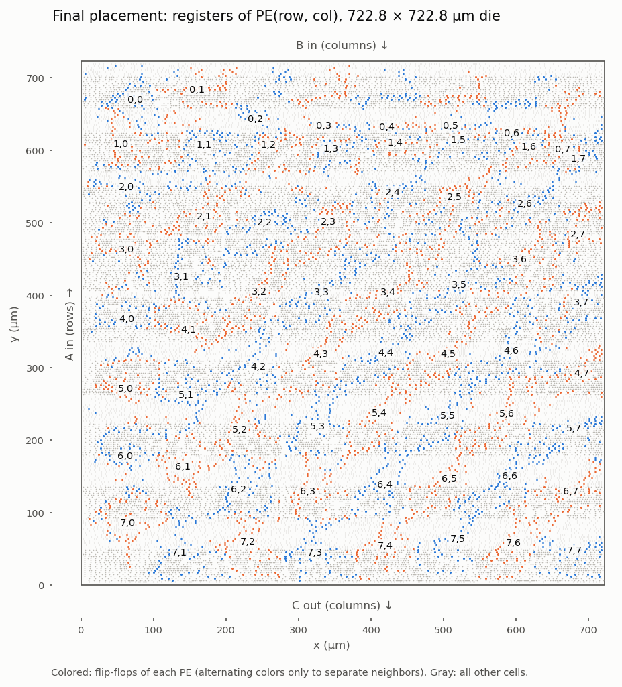

# 8×8 INT8 Systolic Array: RTL to GDSII

A matrix-multiply accelerator, the same idea as the core of Google's TPU, designed from scratch and taken all the
way from SystemVerilog to a signoff-clean chip layout (GDSII) in the open-source **SkyWater 130 nm** process.

## What it is

An 8×8 grid of processing elements. Each one multiplies 8-bit numbers and keeps a 32-bit running sum.
Matrix A flows in from the left and matrix B from the top, and each element computes one entry of
C = A × B. After the last term, the results shift out one row per cycle.

## Key numbers

| | |
|---|---|
| **Process** | SkyWater 130 nm (sky130hd standard cells) |
| **Clock** | 100 MHz, met at the slow, typical and fast corners |
| **Throughput** | 64 multiply-accumulates per cycle (12.8 GOPS) |
| **Die size** | 0.72 × 0.72 mm (0.52 mm²) |
| **Power** | 80.7 mW running, **5.4 mW idle** |
| **Energy** | 17.3 pJ per multiply-accumulate |
| **Signoff** | DRC clean, LVS clean, antenna clean, timing met, gate-level simulation passing |

## Highlights

- **Verified RTL.** Tested against a Python/NumPy reference model with directed and random tests at
  array sizes 1×1 to 8×8. Mutation testing (deliberately broken RTL copies) confirmed the tests catch real bugs.
- **30+ physical-design experiments.** I changed one variable at a time, including utilization, clock period,
  pin placement, cell sizing and pipelining, and recorded the result of each.
- **Full signoff.** Timing was checked across 3 process corners and 6 parasitic-extraction corners. DRC and LVS
  were each checked in two independent tools (Magic/Netgen and KLayout), along with antenna and IR drop.
- **Clock gating cut idle power by 87%** (40.3 → 5.4 mW), and also reduced area by 4.7%.
- **Post-route fixes.** Small scripted changes to the routed layout fixed hold timing and antenna violations
  without disturbing the rest of the design.

*The 8×8 logical array lands as an 8×8 grid on the chip: each colored cluster is one processing element.*

## Tools

SystemVerilog · Verilator · cocotb · Python/NumPy · Yosys · OpenROAD (OpenROAD-flow-scripts) · Magic · Netgen · KLayout

## More detail

- [Technical details](docs/details.md): architecture, verification, every signoff number, and how to reproduce the results.
- Design decisions, the test log and a record of every experiment are kept in a separate project notebook (available on request).
- Side experiment: an on-chip SRAM weight buffer on branch
  [`exp/sram-weight-buffer`](../../tree/exp/sram-weight-buffer). It routed clean, but the open-source SRAM macro
  turned out to have a power short in its own layout, so it isn't part of the final design.

*Scope: block-level design (no pad ring), not taped out.*
