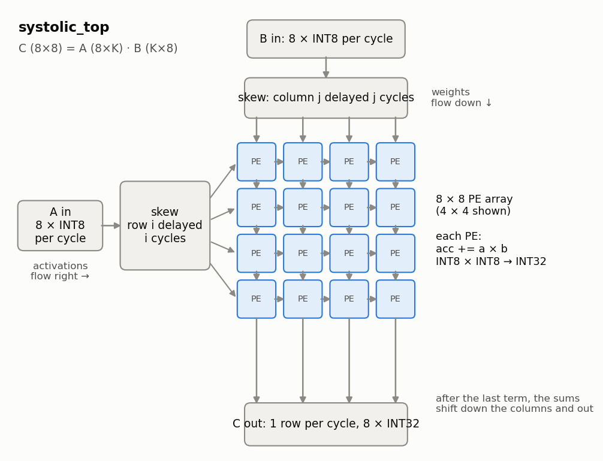
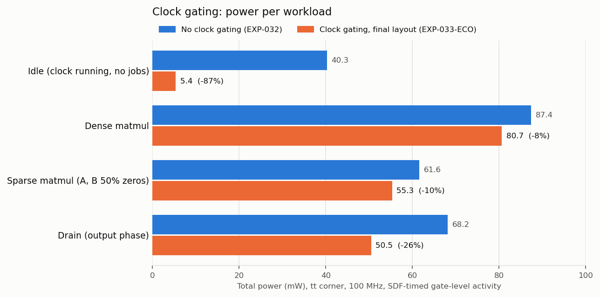

# 8×8 INT8 Systolic Array: RTL to GDSII

A matrix-multiply accelerator, the same idea as the core of Google's TPU, designed from scratch and taken all the
way from SystemVerilog to a signoff-clean chip layout (GDSII) in the open-source **SkyWater 130 nm** process.

## What it is

An 8×8 grid of processing elements. Each one multiplies 8-bit numbers and keeps a 32-bit running sum.
Matrix A flows in from the left and matrix B from the top, and each element computes one entry of
C = A × B. After the last term, the results shift out one row per cycle.

## Key numbers

| | |
|---|---|
| **Process** | SkyWater 130 nm (sky130hd standard cells) |
| **Clock** | 100 MHz, met at the slow, typical and fast corners |
| **Throughput** | 64 multiply-accumulates per cycle (12.8 GOPS) |
| **Die size** | 0.72 × 0.72 mm (0.52 mm²) |
| **Power** | 80.7 mW running, **5.4 mW idle** |
| **Energy** | 17.3 pJ per multiply-accumulate |
| **Signoff** | DRC clean, LVS clean, antenna clean, timing met, gate-level simulation passing |

## Highlights

- **Verified RTL.** Tested against a Python/NumPy reference model with directed and random tests at
  array sizes 1×1 to 8×8. Mutation testing (deliberately broken RTL copies) confirmed the tests catch real bugs.
- **30+ physical-design experiments.** I changed one variable at a time, including utilization, clock period,
  pin placement, cell sizing and pipelining, and recorded the result of each.
- **Full signoff.** Timing was checked across 3 process corners and 6 parasitic-extraction corners. DRC and LVS
  were each checked in two independent tools (Magic/Netgen and KLayout), along with antenna and IR drop.
- **Clock gating cut idle power by 87%** (40.3 → 5.4 mW), and also reduced area by 4.7%.
- **Post-route fixes.** Small scripted changes to the routed layout fixed hold timing and antenna violations
  without disturbing the rest of the design.

*The 8×8 logical array lands as an 8×8 grid on the chip: each colored cluster is one processing element.*

## Engineering challenges

**1. Hitting a timing wall at 6 ns**
- *Problem:* pushing the clock from 7 ns to 6 ns failed setup by 0.07 ns.
- *Root cause:* the worst path started at a control flag, but synthesis had merged the accumulator's add into the
  multiplier's adder tree, so multiply and accumulate formed one long chain.
- *Fix:* split the multiply-accumulate into two pipeline stages with a product register. This was an RTL change,
  kept switchable with a parameter so the old design could still be compared.
- *Result:* 6 ns passed with 0.94 ns to spare, and later 5 ns. Area dropped **19%**: without the merge, synthesis
  needed far fewer full adders, more than paying for the 1,024 added flip-flops.

**2. Slew violations from pin placement**
- *Problem:* signoff showed 19 max-slew and max-capacitance violations, all on input buffers.
- *Root cause:* the pin script packed all 64 weight-input pins into a ~60 µm strip in one corner, so some
  inputs drove 300–430 µm wires across the die.
- *Fix:* give each array lane its own pin region along the edge it feeds.
- *Result:* **0 violations**, 6.6% less wirelength, and better timing, without touching the logic.

**3. Clock gating broke hold timing at the fast corner**
- *Problem:* after adding clock gating, hold failed by 0.031 ns at the fast corner.
- *Root cause:* the gated clock reaches the capturing flops ~0.25 ns late, and the flow only repairs hold at the
  slow corner it optimizes for.
- *Fix:* the obvious fix, rerunning with a hold margin, fixed hold but rebuilt the clock tree and broke setup at
  another corner. I chose a targeted post-route fix instead: 50 delay cells on just the failing paths, with no
  other cell moved.
- *Result:* hold and setup met at all 9 timing corners, followed by a full re-signoff.

**4. A short inside a vendor SRAM macro** (side experiment)
- *Problem:* the SRAM version of the design routed clean, then the final power check reported 132 VDD-to-GND shorts.
- *Root cause:* traced from the error, to the macro's abstract (overlapping power and ground pins), to its
  actual layout (overlapping metal). A standalone extraction of the macro confirmed the short is inside the
  macro itself, and all four SRAM macros shipped with the flow have it.
- *Result:* documented on a side branch and kept out of the final design.

## Skills demonstrated

- **RTL design:** parameterized SystemVerilog, pipelining, valid/ready handshakes, clock-gating enables
- **Verification:** cocotb testbenches, golden-model checking, randomized and directed tests, mutation testing,
  gate-level simulation with SDF timing
- **Physical design:** synthesis, floorplanning, pin planning, placement, clock-tree synthesis, routing, ECOs
- **Timing:** multi-corner and RC-corner static timing analysis, setup/hold closure, clock skew
- **Signoff:** DRC, LVS, antenna, IR drop, electromigration, power analysis
- **Tools:** SystemVerilog · Verilator · cocotb · Python/NumPy · Yosys · OpenROAD · Magic · Netgen · KLayout · Tcl

## What's next

- **Finish the on-chip buffer:** harden my own flop-based 64×64 weight buffer as a macro, replacing the defective
  vendor SRAM.
- **Scale up:** 16×16, to measure how timing, area and clock-tree skew scale with array size.
- **New datapath:** a BF16 processing element using an open-source floating-point unit.
- **Compare dataflows:** a weight-stationary variant against this output-stationary design.

## More detail

- [Technical details](docs/details.md): architecture, verification, every signoff number, and how to reproduce the results.
- Design decisions, the test log and a record of every experiment are kept in a separate project notebook (available on request).
- Side experiment: an on-chip SRAM weight buffer on branch
  [`exp/sram-weight-buffer`](../../tree/exp/sram-weight-buffer). It routed clean, but the open-source SRAM macro
  turned out to have a power short in its own layout, so it isn't part of the final design.

*Scope: block-level design (no pad ring), not taped out.*
